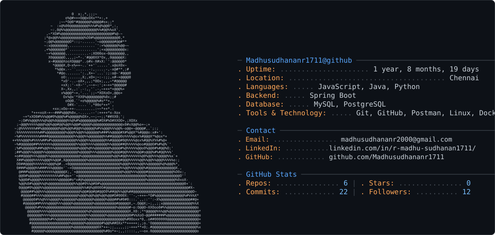

<h1 align="center">Hi 👋, I'm Madhu Sudhanan R</h1>

<h3 align="center">
Java Backend Developer • Spring Boot Developer • AI Enthusiast
</h3>

<picture>
  <source media="(prefers-color-scheme: dark)" srcset="dark_mode.svg" />
  <source media="(prefers-color-scheme: light)" srcset="light_mode.svg" />
  
</picture>
  

---

# 🚀 About Me

🎓 Computer Science Engineering Graduate

💻 Passionate about Java Backend Development and scalable software architecture.

🤖 Interested in Artificial Intelligence, Machine Learning, and Intelligent Healthcare Systems.

🏥 Creator of an AI-powered Hospital Resource Management System designed to predict patient inflow and optimize hospital resources.

🎯 My goal is to build software that solves real-world problems through scalable backend systems and AI.

---

# 🌐 Connect With Me

---

# 💻 Tech Stack

### Languages

### Backend Development

### Database

### Tools & Technologies

### Analytics

- Power BI - Microsoft Excel

# 📊 Contribution Graph

---

# 💡 Favorite Quote

> **"First, solve the problem. Then, write the code."**
>
> — John Johnson

---

# ⭐ Thanks for Visiting!

If you like my projects, consider giving them a ⭐.

Let's build something impactful together! 🚀

  

<h3 align="center">"The best way to predict the future is to build it."</h3>

  

